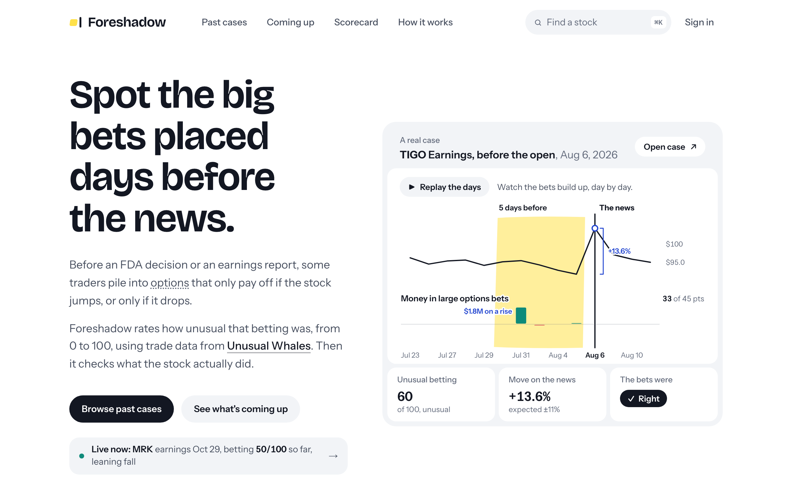
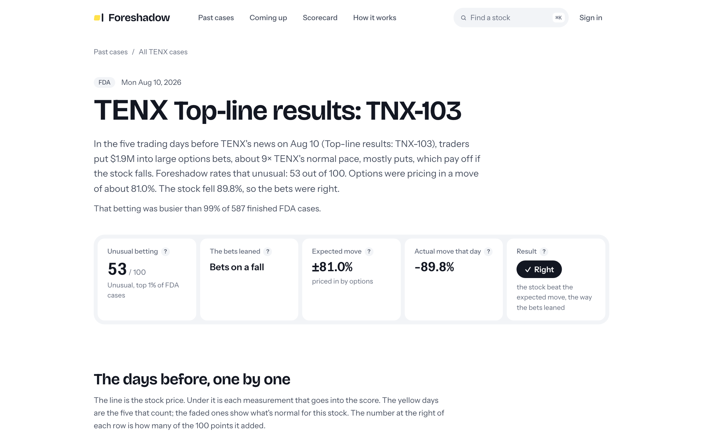
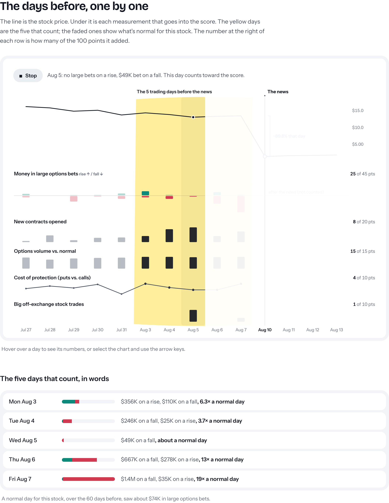
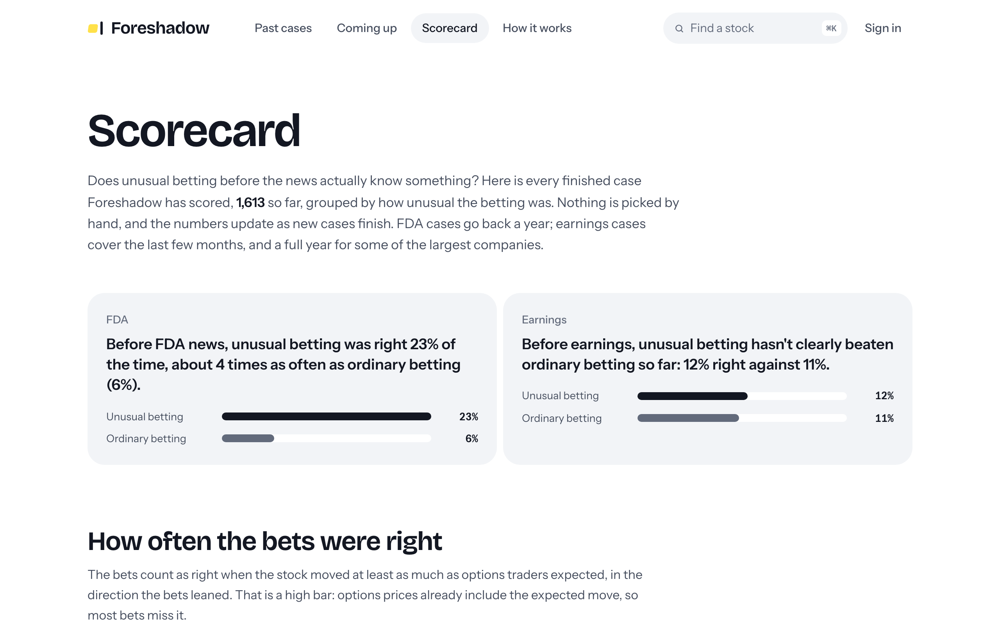
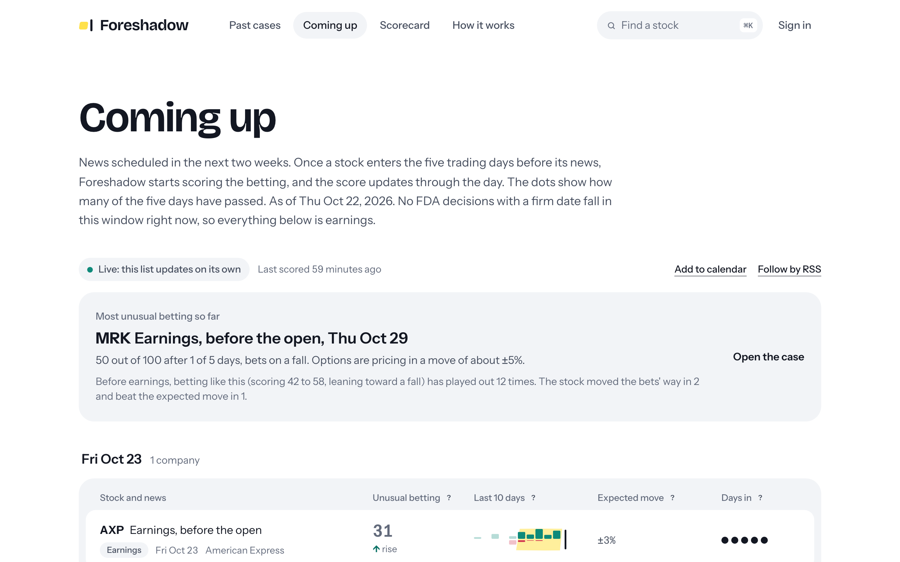
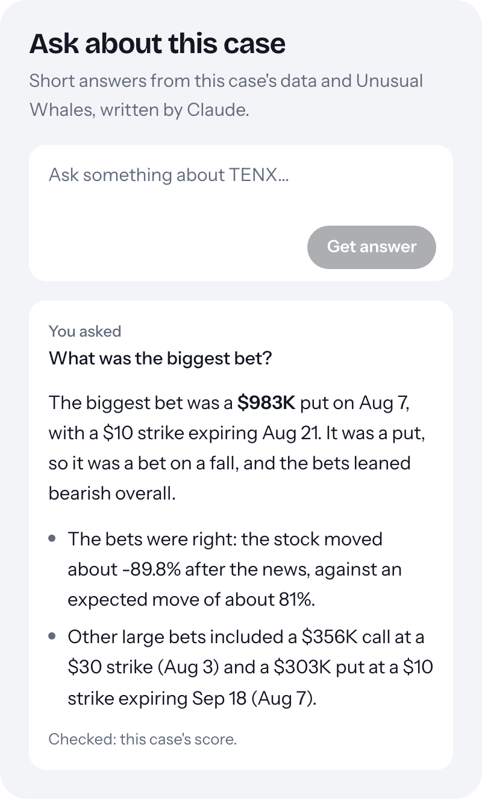
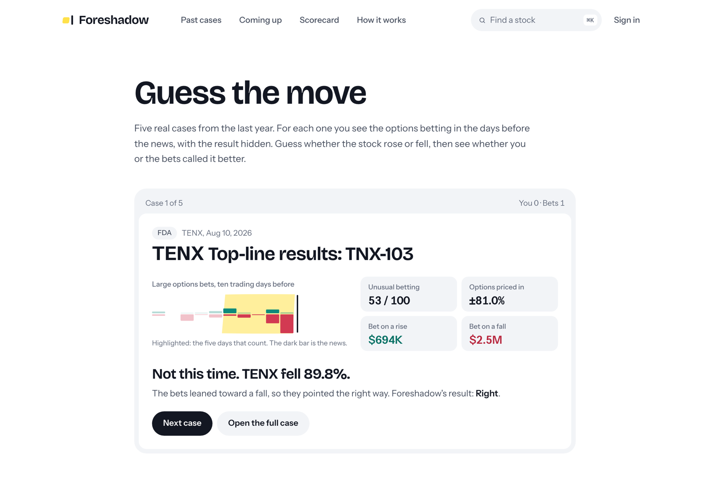

# Foreshadow: *Someone knew. Prove it.*

**Live: [foreshadow-six.vercel.app](https://foreshadow-six.vercel.app)** · [](https://github.com/yashshah1910/Foreshadow/actions/workflows/ci.yml)



Before scheduled company news, like an FDA decision, a drug trial result or an earnings report, some traders pile into options that only
pay off if the stock jumps, or only if it drops. Foreshadow finds that betting in **Unusual Whales** data, rates how
unusual it was from 0 to 100 against the stock's own normal, then checks what the stock actually did.

Built for Unusual Whales Hackathon #1 with Next.js 16 and Supabase. The scorer is plain, deterministic arithmetic
(no LLM anywhere near the numbers); Claude writes the plain-English summaries and answers questions. There is also a
remote MCP server, so Claude can query Foreshadow directly.

The live site covers FDA news from the past year and earnings from the last 90 days (a full year for about 45 of the
largest companies) for US companies worth over $2B with listed options, and scores news coming up in the next five trading days every 15 minutes.

### A two-minute tour

1. **[Home](https://foreshadow-six.vercel.app)**: a real case at the top. Press **Replay the days** to watch the betting
   build day by day before the news.
2. **[A case](https://foreshadow-six.vercel.app/event/fda%3ATENX%3A2026-08-10%3Atop-line-results-tnx-103)**: every large trade
   behind the score, the score's arithmetic, a summary by Claude, and **Ask about this case**.
3. **[Scorecard](https://foreshadow-six.vercel.app/scorecard)**: does unusual betting actually know something? Foreshadow
   grades itself against ordinary betting, and only claims a lift that passes a significance check.
4. **[Guess the move](https://foreshadow-six.vercel.app/guess)**: five real cases with the result hidden. Can you read the
   bets better than the bets themselves?
5. **[Use it from Claude](https://foreshadow-six.vercel.app/docs#mcp)**: add the MCP server with one line, or run any of
   the five tools right on the page.

| Page | What it shows |
| --- | --- |
| **Past cases** `/leaderboard` | Finished news events (the last 90 days unless you pick another window), ranked by how unusual the betting was, with which way the bets leaned, the move options priced in, the actual move, and whether the bets were right. Filters: FDA or earnings, very unusual only, bets were right, 30 days, 90 days or a year; sort by most unusual, newest or biggest move. |
| **Case page** `/event/[id]` | One case end to end: a day-by-day chart (stock price on top, one row per measurement below, the five counted days highlighted), every large trade behind the score, the score's arithmetic, a Claude summary, and "Ask about this case". **Replay the days** steps through the chart one trading day at a time with a plain caption, and **Cases like this one** shows how past cases of the same kind, with a similar score and lean, turned out. Shareable, with a generated preview image. |
| **Stock page** `/ticker/[t]` | Every case for one stock on a timeline, its track record ("very unusual 3 times, right 2 of those") and a Claude summary. It also says when the stock's next news is and when scoring starts, with an RSS feed and a calendar for that stock. Stocks whose news isn't scored yet show what's queued. |
| **Coming up** `/radar` | A calendar of news due in the next five trading days, grouped by day, scored on the part of the five-day window that has already happened, with the most unusual betting so far at the top. Updates arrive through Supabase Realtime. Ask Claude "which news coming up has the most unusual betting?" right on the page. |
| **Scorecard** `/scorecard` | Foreshadow grading itself in public: across every finished case, how often the bets were right by kind of news and score band, against ordinary betting as the yardstick. A lift is only claimed when it clears a significance check at that sample size. Ask Claude "does this actually work?" on the page. |
| **Guess the move** `/guess` | A five-round game on real finished cases: see the ten days of betting before the news with the result hidden, call rise or fall, then compare your record with simply following the bets. Play all cases, FDA news only or earnings only; ↑/↓ on the keyboard work too. |
| **RSS** `/feed.xml` | Upcoming news once its betting turns unusual, plus recent unusual cases, for any feed reader or a Discord RSS bot. |
| **Calendar** `/calendar.ics` | Subscribe in Google, Apple or Outlook calendar: upcoming news whose betting is already unusual, or with `?tickers=AAPL,TSLA` everything coming up for your stocks, each with its live score and a link to the case. |
| **How it works** `/docs` | The method in plain words, then the exact formula, data sources, API and MCP setup, with a score sandbox (move each measurement, watch the score; presets are real cases) and a panel that runs any of the five MCP tools in the browser. |
| **MCP** `/api/mcp` | Remote MCP (streamable HTTP): `foreshadow_score`, `foreshadow_radar`, `foreshadow_history`, `foreshadow_scorecard`, `foreshadow_similar`, plus three prompts (`investigate_case`, `week_ahead`, `stock_track_record`). Plus `packages/mcp-stdio` for stdio-only clients. |
| **Accounts** `/settings` | Supabase Auth without email: a one-click guest account (anonymous sign-in), plus GitHub or Google once switched on in Supabase; the sign-in page only shows the options that are on. Bring your own UW key, stored in Supabase Vault. Watchlists. Discord-webhook alerts when a Coming-up score crosses your threshold. |

## Screenshots

| | |
| --- | --- |
|  |  |
| **Case page**: what happened and whether the bets were right | **Replay the days** and the counted days in words |
|  |  |
| **Scorecard**: Foreshadow grading itself in public | **Coming up**: the next five trading days, scored day by day |
|  |  |
| **Ask about this case**: Claude with Foreshadow's tools and the UW MCP | **Guess the move**: call rise or fall from the betting, then see if you beat the bets |

## Run it locally

```bash
git clone https://github.com/yashshah1910/Foreshadow.git && cd Foreshadow && pnpm install
cp .env.example .env      # leave everything empty for demo mode
pnpm dev                  # http://localhost:3000
```

That's it for the demo: with no keys the app serves the seeded dataset from `supabase/fixtures/`.

With Supabase (Docker running):

```bash
pnpm supabase start && pnpm supabase db reset   # applies migrations + seed.sql
# put the printed URL and keys in .env (see Keys below), then pnpm dev
```

With a UW key, replace the seed with real data:

```bash
pnpm ingest --mode backfill --days 90 --kinds fda,earnings   # scores the last 90 days; resumable, safe to rerun
pnpm ingest --mode radar                                     # scores the next 10 trading days
```

Useful flags: `--min-cap 2e9` (earnings market-cap floor, the default), `--concurrency 3` (the hackathon key allows
3 requests in flight), `--max N`, `--dry-run`, `--loop`. `pnpm uw:check AAPL` reports how far back your UW plan's
history goes.

Checks: `pnpm test` (201 tests: scorer, UW client, narrator, plain-English wording, similar cases, rate limits), `pnpm typecheck`, `pnpm lint`. CI runs all three plus a demo-mode build on every push.

## Keys

| Variable | Needed for |
| --- | --- |
| `NEXT_PUBLIC_SUPABASE_URL`, `NEXT_PUBLIC_SUPABASE_PUBLISHABLE_KEY` | Accounts, BYOK, watchlists, alerts, Realtime. Empty → demo mode from fixtures. |
| `SUPABASE_SECRET_KEY` | The ingest, the narration cache and server-side reads; required, because raw Unusual Whales data (`footprints`, `catalysts.payload`) is readable by the service role only. (`SUPABASE_SERVICE_ROLE_KEY` also works.) |
| `UW_API_KEY` | Fresh scoring and Coming up. Signed-in users can bring their own key instead (Settings → stored in Vault). |
| `ANTHROPIC_API_KEY` | The case summaries, stock summaries, the Ask panel and the catalyst tagger. **Without it every surface still works**; the story slot shows the deterministic template. |
| `CRON_SECRET` | Protects `/api/cron/ingest`. Vercel Cron sends it as a Bearer token; the GitHub Actions radar workflow needs it as a repo secret. |
| `RESEND_API_KEY` | Optional email alerts; needs a sending domain verified in Resend, so the hosted site uses Discord webhooks only. |
| `NEXT_PUBLIC_POSTHOG_KEY` | Optional product analytics (PostHog, proxied through `/ingest`). Empty → nothing is sent. |

No keys live in the repo; copy `.env.example`.

## The score

One number per (ticker, event), 0–100, plus a direction and, for past events, a verdict. Reproducible from the rows
on the card.

- **Windows.** Footprint = trading days T-5 → T-1. Baseline = the 60 trading days before that (T-65 → T-6). NYSE
  holidays are skipped.
- **Signals** (each a z-score of the footprint window against the ticker's own baseline):

  | Signal | UW endpoint | Computed | Weight |
  | --- | --- | --- | --- |
  | Flow-alert intensity | `/api/option-trades/flow-alerts` | alerts/day and premium/day vs baseline, plus sweep share | 25% |
  | Directional premium | same, by call/put and ask/bid side | ask-side calls − ask-side puts per day | 20% |
  | New open interest | `/api/stock/{t}/oi-change` | Σ \|OI change\| per day; call/put imbalance feeds direction | 20% |
  | Volume unusualness | `/api/stock/{t}/options-volume` → percentile (`/unusualness` for today) | 0–100 percentile used directly | 15% |
  | Skew shift | `/api/stock/{t}/historical-risk-reversal-skew` | change in 25Δ put−call IV across the window | 10% |
  | Dark pool prints | `/api/darkpool/{t}` | notional of prints ≥ $1M vs baseline | 10% |

- **Formula.** `Score = Σ wᵢ · min(max(zᵢ, 0) / 4, 1) · 100`. Dollar metrics are log1p-transformed before the z-score.
  Direction = sign of `z(directional premium) + 2·OI imbalance − z(skew shift)`; |·| < 0.5 is "mixed".
  Under 40 is ordinary, 40 to 70 is unusual, 70+ is very unusual (the site highlights these).
- **Verdict.** Close-to-close move on the reaction day (T for pre-market/intraday, T+1 for after-hours) vs the implied
  move (UW earnings expected move, else the 1-day interpolated implied move at T-1, else a stated 4% fallback).
  Matched = ≥ 1× implied and the sign agrees with the direction.
- **Noise controls.** Index/ETF tickers never rank. < 20 baseline days with activity → "insufficient history".
  ≥ 2 catalysts in the window → flagged multi-catalyst. Only events with a verified outcome rank.
- **History depth.** If the UW plan refuses dates older than N days the loader finds the cut-off itself, shrinks the
  baseline to what is available and records a warning on the ingest run; the scoring still works with a 20-day
  baseline, Past cases just covers a shorter span.

Implementation: `packages/core/src/{windows,scorer,verdict}.ts` with tests in `packages/core/tests/`.

## Where Claude fits

Claude never computes a number. `packages/narrator/` wraps the Messages API for four jobs:

1. **Narrator**: a short story and a shareable caption per case, written for people who don't trade, from the raw alert rows, with a strict
   JSON output contract. Every number in the story is checked against the input rows; if one can't be verified the
   call is retried once, then the template is shown. The rows render beside the story so a reader can check.
2. **Catalyst tagger**: maps President's-schedule and economic-calendar rows to tickers and sectors with a confidence.
3. **Ask** (on case pages, stock pages, Coming up and the Scorecard, with up to three follow-ups in a thread): a short tool loop (at most 4 calls) over the five
   Foreshadow tools **and the Unusual Whales hosted MCP** (`https://api.unusualwhales.com/api/mcp`, with the
   user's own key, falling back to Foreshadow's tools when that server is unreachable). Questions about the scored
   window go to Foreshadow's tools; questions about right now ("what's the latest options flow?") go to the UW MCP
   server's live flow alerts, and the answer credits it. Answers are under 120
   plain-English words. Questions outside the case, the stock or Foreshadow get one fixed sentence and no tool calls.
4. **Stock summary**: one paragraph on whether unusual betting keeps showing up before a stock's news.

Model: `claude-haiku-5-5` (override with `NARRATOR_MODEL`). Case summaries are cached by (case, score). Every route that
spends credits is rate-limited per IP (`lib/rate-limit.ts`): Ask allows 3 questions a minute, 12 an hour and 40 a day;
summaries fall back to the deterministic template when a visitor goes over.

## MCP

```bash
claude mcp add --transport http foreshadow https://<your-host>/api/mcp
```

In Claude on the web or Claude Desktop: Settings → Connectors → Add custom connector, and paste the same URL. In Cursor,
add `{ "mcpServers": { "foreshadow": { "url": "https://<your-host>/api/mcp" } } }` to `.cursor/mcp.json`. For clients that
only run local stdio servers, `pnpm --filter foreshadow-mcp build`, then run
`FORESHADOW_URL=https://<your-host> node packages/mcp-stdio/dist/index.js` (see `packages/mcp-stdio`).
Try: *"was there unusual options betting before Tesla's Oct 21 earnings?"*

A real exchange with the live server (Claude Sonnet 5.5 through the MCP connector, Oct 23 2026; the similar-case
counts change as new cases finish):

> **You:** Was there unusual options betting before TENX's FDA news in August, and has betting like that been right before?
>
> *Claude calls `foreshadow_history`, `foreshadow_score` and `foreshadow_similar`.*
>
> **Claude:** Yes. The betting before TENX's Aug 10 TNX-103 results scored 53/100. Puts dominated: about $2.5M
> against $0.7M in calls, and the largest trade was a roughly $983K put bought Aug 7, the last trading day before the
> news. The bets were right: the stock fell about 90%, past the roughly 81% move options had priced in.
> Has it been right before? Of seven similar finished cases (FDA news, betting leaning toward a fall, score 37–69),
> the stock moved the bets' way in 5 and beat the expected move in 2. It's a small sample.

All five tools are marked read-only. The server also offers three prompts, which Claude shows as slash commands:
`investigate_case` (ticker, date), `week_ahead` and `stock_track_record` (ticker). Each one chains the tools and asks
for a short answer in plain English. You can also run every tool from the "Try the tools here" panel on `/docs#mcp`.

The five tools have REST twins with the same JSON:

| Tool | REST | Returns |
|---|---|---|
| `foreshadow_score` | `GET /api/score?ticker=&eventDate=` | The case (`id`, `ticker`, `kind`, `eventDate`, `title`, `score` (whole number), `band`, `direction`, `verdict`, `result` (the three outcomes in words), `impliedMovePct`, `realizedMovePct`, `flags`), its `url`, the six `signals` (weight, z, contribution, window vs baseline), `trades: { count, totalPremium, largest }` and `verdictDetail` |
| `foreshadow_radar` | `GET /api/radar?daysAhead=&minScore=` | `today` and `items`: upcoming cases with the same summary fields plus `windowStart`, `windowOpen`, `daysElapsed`, `daysTotal` |
| `foreshadow_history` | `GET /api/history?ticker=` | `ticker`, `company`, `hitRate` and `events` (case summaries) |
| `foreshadow_scorecard` | `GET /api/scorecard` | `cases`, `definition` and per kind of news a `finding` plus `bands` (`scores`, `cases`, `rightPct`, `movedMoreThanExpectedPct`, `movedWithLeanPct`) |
| `foreshadow_similar` | `GET /api/similar?ticker=&eventDate=` | The `case`, what it was `matchedOn` (kind, lean, score range), `similarCases`, `betsRight`, `rightPct`, `movedTheirWay`, `movedTheirWayPct` and the `closest` case summaries |

These are Foreshadow's results, not a copy of Unusual Whales data. `trades.largest` holds at most five example trades,
each only `{ tradeDate, type, strike, expiry, premium, isSweep }`: no alert ids, timestamps, contract counts or other raw
fields. Case pages show the ten largest the same way, and `/api/ask` returns only the answer and the names of the sources
it used. Stored scores keep the same trimmed trades, and the raw cached responses (`footprints`) and catalyst
calendar rows (`catalysts.payload`) are readable by the service role only; pages get the company name, sector and
size from those rows, never the rows themselves.

## Architecture

```
app/                     Next.js 16 App Router (Turbopack, Tailwind 4)
  page.tsx               home: what it does, a real case, how it works, the most unusual cases
  leaderboard/ event/[id]/ ticker/[t]/ radar/ scorecard/ guess/ docs/ settings/ login/
  feed.xml calendar.ics  RSS and iCalendar feeds
  globals.css            the design tokens (light only; grouping by tinted trays, no divider lines)
  api/cron/ingest        fetch UW → score → upsert Supabase (Vercel Cron daily; GitHub Actions every 15 min in market hours for the radar)
  api/mcp                remote MCP (mcp-handler, streamable HTTP)
  api/narrate api/ask api/dossier    Claude route handlers
  api/score api/radar api/history api/scorecard api/similar    REST twins of the MCP tools (used by the stdio wrapper)
lib/data/                one DataSource interface, two implementations: Supabase (reads cached for a few minutes) or the JSON fixtures (demo mode)
lib/ingest.ts            the pipeline shared by the cron route and `pnpm ingest`
packages/core/           scorer.ts, windows.ts, verdict.ts + tests  (pure, deterministic)
packages/uw/             typed client for the UW endpoints, rate limiter, Supabase-backed cache, footprint loader + tests
packages/narrator/       Claude Messages API: story, tagger, investigator loop, dossier + tests
packages/mcp-stdio/      stdio wrapper that proxies to the REST endpoints
supabase/                migrations (schema + RLS + Vault functions), seed.sql, fixtures/
scripts/                 generate-seed.ts (synthetic demo data), ingest.ts (local backfill), depth-check.ts
vercel.json              cron schedules
```

Supabase holds every row (Postgres), every user (Auth), every user's UW key (Vault, via `set_uw_key` /
`get_uw_key` functions; the key never sits in a table column) and pushes Radar updates to the browser (Realtime on
`scores`). RLS: scores and catalysts are readable by everyone, except the raw UW rows: `footprints` and the
`catalysts.payload` column are readable by the service role only; everything is written only by the service role from the cron, and everything
user-owned is owner-only.

## The demo dataset is synthetic

`supabase/fixtures/` and `supabase/seed.sql` are generated by `scripts/generate-seed.ts` with a fixed seed: 28
**fictional** tickers, 72 catalysts, ~4,000 ticker-days of UW-shaped alerts, OI changes, dark pool prints and
OHLC, scored by the real scorer. Nothing in it is real market data, and a banner across the top of every page says
so. The live site runs on Supabase with real Unusual Whales data; the fixtures exist so the app runs with no keys.

## Not financial advice

Foreshadow detects positioning, not intent. A high score is a statistical anomaly relative to a ticker's own
history; it is never an allegation that anyone traded illegally.

MIT © 2026 Yash Shah
